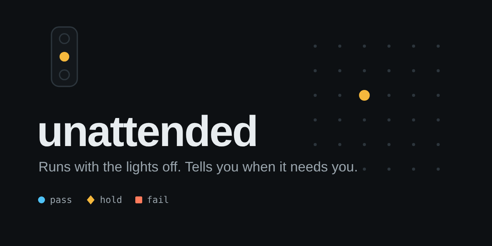
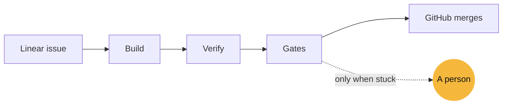

  

<h3 align="center">Ship while you sleep. Get woken up only when it matters.</h3>

  <b>unattended</b> is a dark software factory. 
  Your Linear backlog goes in. Verified, gated pull requests come out.

  <a href="https://unattended.unmerged.tech"><b>Website</b></a> ·
  <a href="#whats-coming">What's coming</a> ·
  <a href="https://github.com/mikegorelikoff">Author</a>

  
  
  

---

## Work in progress. Lights are about to go off.

Most of a backlog is work you already know how to do. It still costs a context switch, a review and an afternoon, every time.

unattended takes that work off your plate and keeps the standard where it was. It does not ask you to trust an agent. It asks an independent verifier, a set of deterministic gates and GitHub's own branch protection, and it stops loudly when any of them says no.

The result is a factory that looks like nothing is happening, until the one moment something needs you.

## What's coming

- **A factory that reads your backlog.** Label an issue, and it is picked up. No new tool to learn.
- **A second opinion on every change.** The author never grades its own work.
- **Merges you can accept without reading.** GitHub has the last word, always.
- **A console that stays quiet.** One glance, a few times a day. One amber light when it needs you.
- **Trust that is earned.** Every kind of work starts supervised and moves up on evidence.
- **One install.** A single command, configs you can read and review.

The first release is being built in the open, stage by stage.

## Follow along

Star the repository to see it land, and watch the [website](https://unattended.unmerged.tech) for the first night shift.

  

---

unattended · built by <a href="https://github.com/mikegorelikoff">Mihail Gorelikov</a> · Copyright 2026 Mihail Gorelikov
