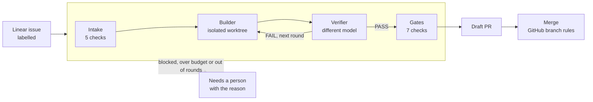
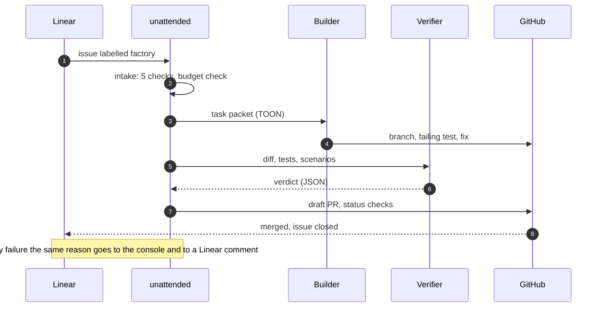
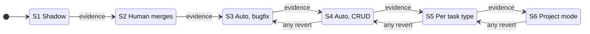
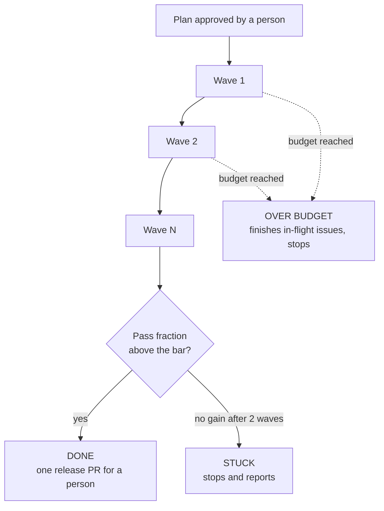
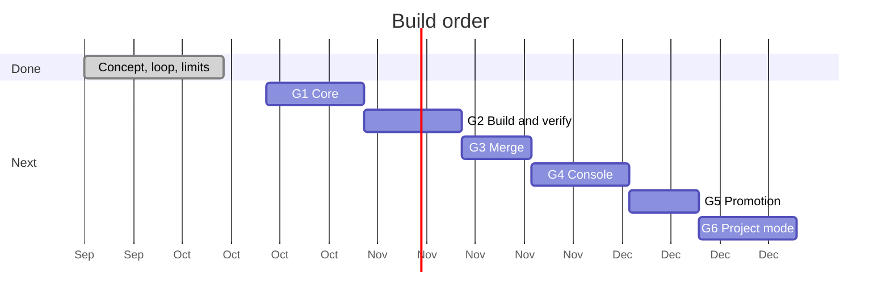

<p align="center">
  
</p>

<h3 align="center">Ship while you sleep. Get woken up only when it matters.</h3>

<p align="center">
  <b>unattended</b> is a dark software factory. Your Linear backlog goes in.<br>
  Verified, gated, merged pull requests come out. A person is paged only when something needs one.
</p>

<p align="center">
  <a href="https://unattended.unmerged.tech"><b>Website</b></a> ·
  <a href="#how-it-works">How it works</a> ·
  <a href="#quickstart">Quickstart</a> ·
  <a href="#the-console">Console</a> ·
  <a href="#roadmap">Roadmap</a> ·
  <a href="https://github.com/mikegorelikoff">Author</a>
</p>

<p align="center">
  
  
  
  
  
</p>

---

## Your backlog is not the bottleneck. Your attention is.

Most of a backlog is work you already know how to do: the bug with a clear reproduction, the CRUD screen, the dependency bump, the refactor with tests. It still costs a context switch, a review and an afternoon, every time.

**unattended takes that work off your plate and keeps the standard where it was.** It does not ask you to trust an agent. It asks an independent verifier, a set of deterministic gates and GitHub's own branch protection, and it stops loudly when any of them says no.

The result is a factory that looks like nothing is happening, until the one moment something needs you.

> **Status: pre-alpha.** The concept and the loop are done, and the installer is being built in the open. Nothing is on npm yet. Commands below show the target behaviour. [Follow the author](https://github.com/mikegorelikoff) to watch it land.

## Why it is different

| | A coding agent in your editor | A pipeline of scripts | **unattended** |
| --- | --- | --- | --- |
| Starts from | a prompt you write | a trigger you wire | **an issue in Linear** |
| Who checks the work | the same model | tests only | **a different model, held-out scenarios and gates** |
| Runs while you are away | no | yes | **yes, with a budget and a pause switch** |
| When it fails | it keeps trying | it goes red | **it stops and says why, in Linear and in the console** |
| What it costs | unknown | unknown | **metered per call, per issue, per day** |
| How far it is trusted | all or nothing | all or nothing | **earned per task type, from shadow mode up** |

## How it works



| Stage | Who acts | What it returns |
| --- | --- | --- |
| **Intake** | Code | Five checks. "Not taken. Missing: Acceptance criteria, Size." |
| **Builder** | Agent (headless Claude Code) | A branch with a failing reproduction test, then the fix |
| **Verifier** | A different model | A strict JSON verdict: PASS or FAIL, with risks |
| **Gates** | Code | CI, acceptance scenarios, diff budget, forbidden paths, dependencies |
| **Merge** | GitHub | Required checks `factory/verifier` and `factory/gates`, then auto-merge or a queue |

The Builder never grades its own work. Held-out scenarios, which the Builder cannot read, decide acceptance. And the final word is GitHub branch protection, not the factory.

### The life of one issue



## Built on six ideas

**1. Real systems only.** Real Linear, real GitHub, real money. No mocks in the loop, so what you see in shadow mode is what you get in production.

**2. Every call is metered.** A token ledger and budgets are checked before each call, per issue and per day. The number that matters is cost per accepted change, and you can read it on one screen.

**3. Promotion is earned.** Each task type climbs six stages, from shadow mode to project mode, on evidence: accepted changes, reverts, verifier agreement, cost. One revert drops it a stage.



**4. A failure is never silent.** Every Hold or Fail carries its cause with a number or a name: "The failing gate is acceptance/checkout, at 0.62 against a bar of 0.90." The same text appears in the console and in the Linear comment.

**5. One switch.** Pause stops everything. Calls in flight finish their current step, nothing new starts, and the pause is written to the audit log.

**6. Config people and models both read.** Every file is [TOON](https://github.com/toon-format/toon), a compact format that is easy to review in a diff and cheap to put in a model's context.

## Quickstart

```bash
npm i -g unattended
unattended init        # writes .unattended/config.toon, checks Linear and GitHub access
unattended doctor      # verifies tokens, branch protection, sandbox
unattended run --once  # shadow mode: drafts PRs, a person merges
unattended ui          # web console on 127.0.0.1:7421
```

A complete config fits on one screen:

```toon
version: 1
mode: shadow
linear:
  team: ENG
  label: factory
budgets:
  issue_usd: 5.00
  day_usd: 60.00
max_rounds: 3
workers: 1
```

Start in **shadow mode**: the factory drafts pull requests and a person merges every one. When the numbers say it has earned more, promote a task type from the console. Never before.

## The console

One shell, eight screens, and the header always shows whether anything needs a person and lets you pause from anywhere.

| Screen | Answers |
| --- | --- |
| **Overview** | Is anything needed from me? What did it cost today? |
| **Queue** | What is in flight, waiting, rejected or merged? |
| **Issue** | What happened to this one, stage by stage, and why did it stop? |
| **Cost** | Where does the money go, per stage and per task type? |
| **Scenarios** | Which held-out scenarios exist, who approved them, how often do they pass? |
| **Task types** | How much is each type trusted, and what is the evidence for the next step? |
| **Project** | For a whole project: the issue graph in waves, the pass fraction, the budget |
| **Config** | Edit TOON with a diff and validation, nothing saves unconfirmed |

## Project mode

Point it at a whole project, not one issue. A planner reads the Linear graph, groups issues into waves that never touch the same files, and builds wave by wave against held-out acceptance scenarios.



Nothing ships without a person approving the release.

## Put it on your own domain

An optional nginx deploy serves the console on your domain, with sign-in, `viewer` and `operator` roles, CSRF protection, trusted-proxy handling, systemd units and a compose file. Operators can pause from a phone.

## Roadmap



- [x] **Concept**: the loop, the project layer, the limits
- [ ] **G1 Core**: Linear client, intake, token ledger, TOON config
- [ ] **G2 Build and verify**: worktrees, Builder, Verifier, gates
- [ ] **G3 Merge**: branch protection, auto-merge, escalation
- [ ] **G4 Console**: web UI, roles, nginx deploy
- [ ] **G5 Promotion**: S1 to S6, evidence and demotion
- [ ] **G6 Project mode**: planner, waves, held-out scenarios
- [ ] **Native Linear agent**: delegate an issue to unattended instead of labelling it

Dates are a plan, not a promise.

## Honest limits

A dark factory does not remove review. It moves review to places that scale: a second model, held-out scenarios, gates and branch protection. Without those, a green pipeline can still be wrong. Start in shadow mode, keep budgets low, and promote a task type only when the evidence says so.

## Author

Built in the open by **[Mihail Gorelikov](https://github.com/mikegorelikoff)** under **[unattended-factory](https://github.com/unattended-factory)**. Site: [unattended.unmerged.tech](https://unattended.unmerged.tech).

If this is the factory you wanted to exist, **star the repo** and follow [@mikegorelikoff](https://github.com/mikegorelikoff): that is the fastest way to know when the first release ships.

## License

[Apache License 2.0](LICENSE). Copyright 2026 Mihail Gorelikov.
